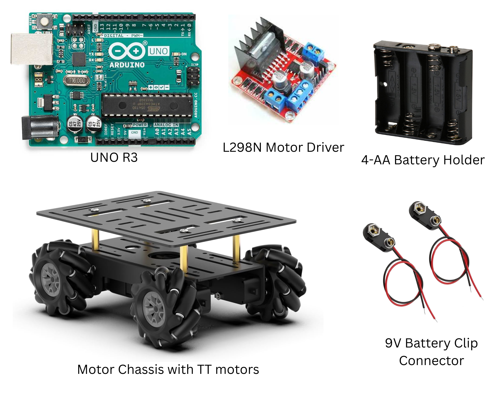
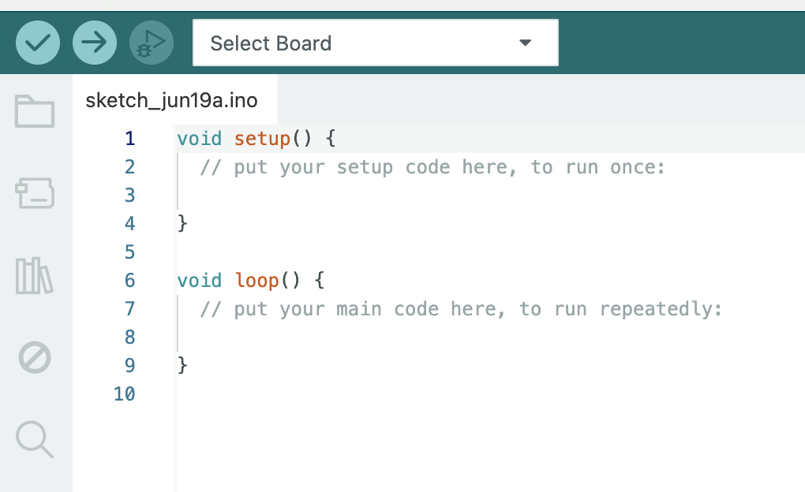

This is my first post in a series of posts describing my journey with the goal of building an autonomous robot which can navigate by itself. The robot will look like a car and I plan to use it as a security guard in my front yard.

## Gathering required components

- Arduino microcontroller (or Raspberry Pi)
- A chassis for the body of the robot (the one I ordered came with omnidirectional wheels and TT motors)
- TT motors to drive the wheels (if not included with the chassis)
- Motor drivers: L298N (each one can drive two motors, for this project I need two)
- 4-AA battery holder to power the motors
- A 9V battery cable to power the Arduino

Most of these components can be bought on Amazon or other online stores like Adafruit. Here are some pictures of the parts I ordered

## Setting up Arduino IDE

The brain of the robot is the Arduino UNO R3 microcontroller board. All the instructions to the robot are executed on this microcontroller. We need a way to develop code for this platform and upload it to the on board memory of the microcontroller. This is where Arduino IDE comes to the rescue.

Getting started with Arduino IDE is very straightforward. The instructions can be found [here](https://projecthub.arduino.cc/Arduino_Genuino/getting-started-with-the-arduino-desktop-ide-0aa470). The best way to test your setup is to execute the *Blink* from the included examples. You can find this under File -> Examples -> Basic -> Blink.

Arduino being a microcontroller has no OS to boot up. On power on there is some initialization done to the board and the code you upload to it is run repeatedly until the power is off. The IDE has two sections to capture this behavior. The first section is a function called ***setup()*** where you put your code which is only run one time at the beginning. The second section is a function called ***loop()*** where you put your main code which is run repeatedly.

## Notes and observations

I try to capture all my observations or questions I had during the build here. Most of these questions are answered either by my father or I use the internet.

### Raspberry Pi or Arduino?

Arduino UNO R3 is a microcontroller whereas Raspberry Pi is a general purpose microcomputer. Here are the differences I understood from studying these two. You can find more information about them on the internet.

| Feature | Arduino UNO R3 | Raspberry Pi |
|---|---|---|
| Boot up | No boot up (very fast) | Boot up the OS (Linux) |
| OS | None | Linux |
| Computing power | Limited | More powerful |
| Memory | Limited | Upto 8GB |
| Interface to various sensors | Trivial | Trivial |
| Power consumption | Low | High |
| Beginner friendly | Yes | No |

### Need for motor drivers

Recall that in the parts list I mentioned about L298N motor drivers! These are needed to drive the TT motors because the motors draw significantly more current than the Arduino's GPIO pins can safely provide. Attempting to power motors directly from the Arduino's pins could **damage the microcontroller.**

The L298N acts as an interface or power amplifier. It takes the low-power control signals (on/off, direction) from the Arduino's microcontroller and uses them to **switch and deliver the much higher current and appropriate voltage from a separate motor power supply** to the motors. In essence, the Arduino tells the L298N what to do, and the L298N provides the necessary power.
