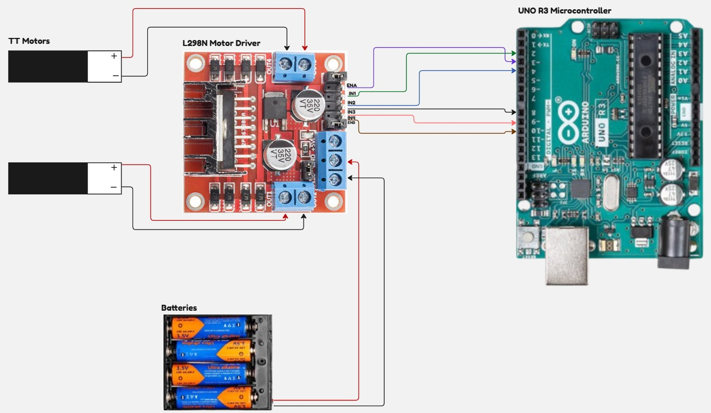
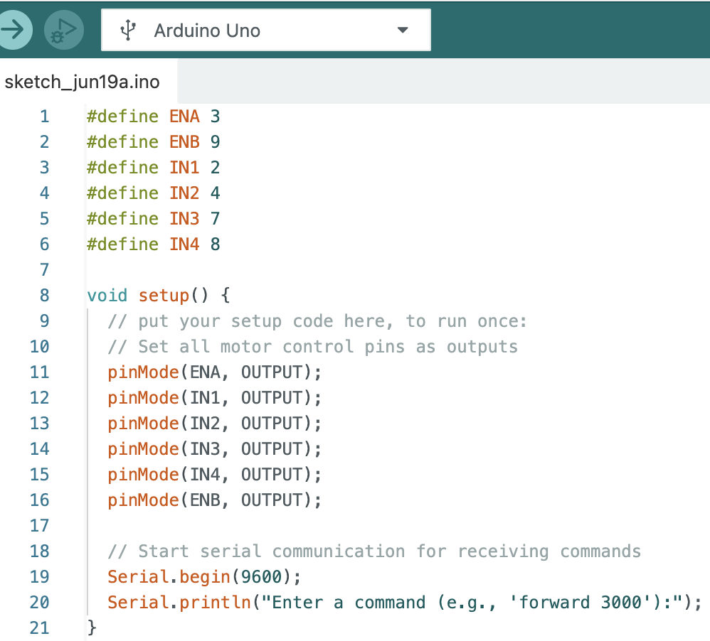
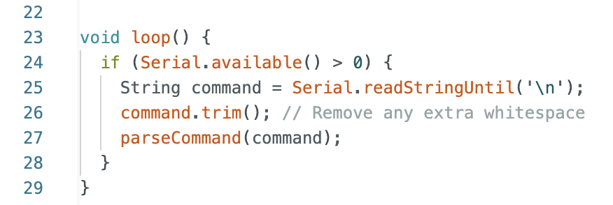
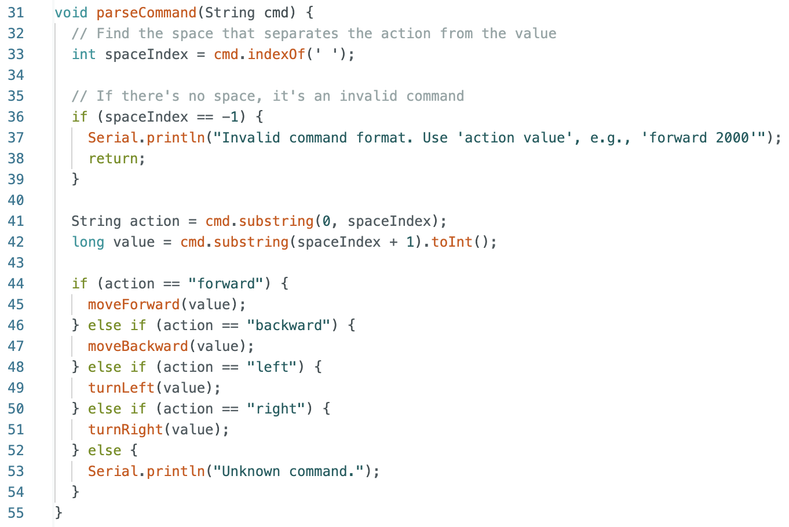
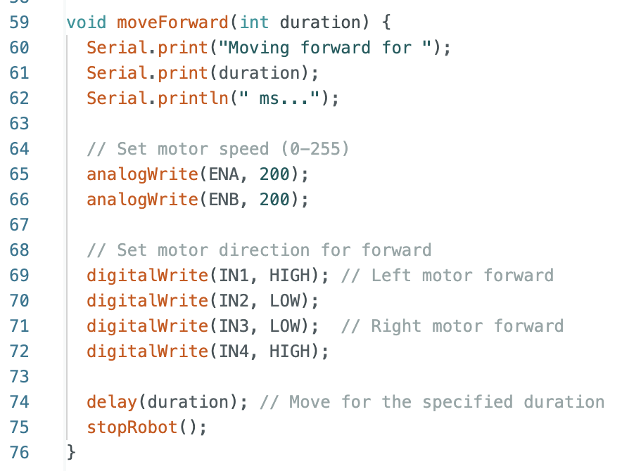
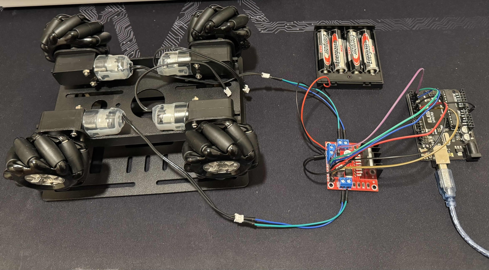

Today's main goal is to connect Arduino Uno to the motors using the motor driver and if possible code some instructions to move the wheels. If you have been following this series, checkout my first post [Day 1: Setting up Arduino and gathering parts](/day-1-setting-up-arduino-and-gathering-parts/).

### Voltages and Currents

Before we get started, a little introduction to voltages and currents and power requirements. I highly recommend checking [this book](https://www.allaboutcircuits.com/textbook/direct-current/chpt-1/voltage-current/) out for a great introduction to electricity, voltages and currents.

The battery pack holds 4 AA batteries connected in series, providing a total voltage of 6V (1.5V × 4). The TT motors specify an input voltage range of 3V - 6V, so they can be safely powered by the 4 AA battery configuration.

Each TT motor typically draws 300mA - 500mA of current during normal operation, depending on the mechanical load. Typical alkaline AA batteries have a capacity of 2000mAh - 3000mAh. Since my batteries don't specify their capacity, I'll assume an average of 2500mAh. This means the battery pack can theoretically supply 2500mA for 1 hour, 1250mA for 2 hours, 625mA for 4 hours, and so on.

With two TT motors connected in parallel to the same battery pack, and assuming each motor draws an average of 300mA, the total current draw would be approximately 600mA. At this consumption rate, the batteries should last for about 4 hours (2500mAh ÷ 600mA ≈ 4.2 hours).

As the calculations above show, the battery pack is already operating near its capacity limits with just the two motors. Therefore, the Arduino requires its own separate power supply to avoid overloading the motor batteries and to ensure reliable operation. During development and testing, the Arduino is powered through the USB connection from the computer. For standalone operation without the USB connection, the Arduino should be powered by a separate 9V battery connected to its power jack, which will be regulated down to 5V by the Arduino's onboard voltage regulator.

### Circuit Diagram

A circuit diagram illustrates how the various components of a circuit are interconnected. Creating a diagram is an essential first step before building the actual circuit, as it helps visualize connections, identify potential issues, and serves as a reference during construction. You can create circuit diagrams using specialized software like Fritzing or KiCad, general diagramming tools, or even hand-drawn sketches on paper. The circuit we will be building is shown in the diagram below.

The L298N motor driver acts as a power amplifier, providing the high current needed to drive the motors while being controlled by low-current signals from the Arduino. The enable pins (ENA and ENB) control whether each motor output is active. By default, small jumpers connect these pins to VCC (the positive battery terminal), keeping the motors always enabled. To allow Arduino control over motor speed, these jumpers must be removed and the enable pins connected to PWM-capable pins on the Arduino (identifiable by the "\~" symbol next to the pin number).

The direction control pins IN1, IN2, IN3, and IN4 determine the rotation direction of each motor. IN1 and IN2 control Motor A, while IN3 and IN4 control Motor B. These are digital inputs that interpret +5V as logic "1" and 0V (ground) as logic "0".

For each motor, the direction is determined by the combination of its two control pins:

- Different values (IN1=1, IN2=0 or IN1=0, IN2=1) cause the motor to spin in opposite directions
- Same values (both 0 or both 1) cause the motor to stop or brake

The specific direction (forward vs. reverse) for each combination depends on how the motor wires are connected and can be determined through experimentation.

### Coding Arduino Logic

The Arduino needs instructions to know how to behave when powered on, including how to configure its pins and control the PWM outputs. To make the code more readable and maintainable, it's good practice to define descriptive names for the pins instead of using pin numbers directly. Based on our circuit connections, here are the pin definitions I'll use. You should modify these to match your actual wiring if you've connected to different pins.

I am using the serial port on the Arduino to receive commands. The commands can be simple ones like "forward 3000" to instruct the motors to spin in forward direction for 3000us or 3s. Next, we have to write code in the loop() function to wait for these commands and execute the necessary code to control the motors based on these commands. My loop() function looks like this.

The loose translation of above code reads like this:

- Check if there is anything available to read on the serial port
- If yes, read the string until you reach "\\n" which is a newline character (when you press "Enter" on the keyboard)
- Trim or cut any trailing whitespace
- Call a function to parse the command

The parseCommand is a function which parses the input string to determine what action to be taken.

The action functions moveForward, moveBackward, turnLeft and turnRight are the final functions which sets the appropriate voltages on the pins. For brevity, I am showing here only the definition of moveForward. The others can be derived using similar logic. The full code is uploaded on my github link.

### Building the Circuit and Testing

Once you are confident about the workings of the circuit diagram and the code to control it, you start building the circuit. It can be clumsy to begin with, all you care about at this stage is the correctness of the connections. More importantly this is the time you test your connections fully before building the final product. My testing setup looks like this.

