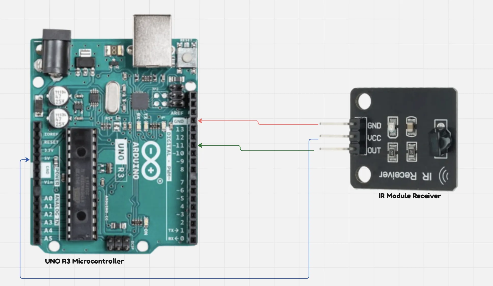
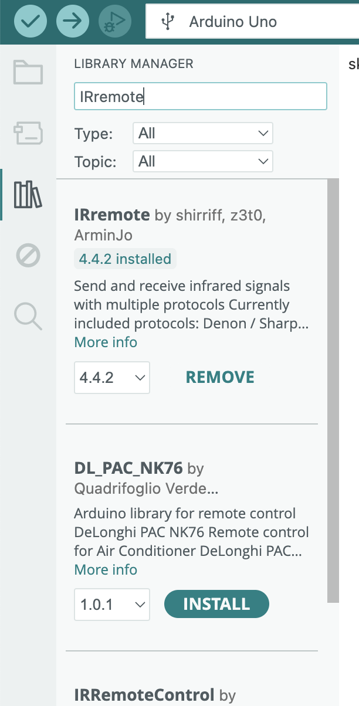
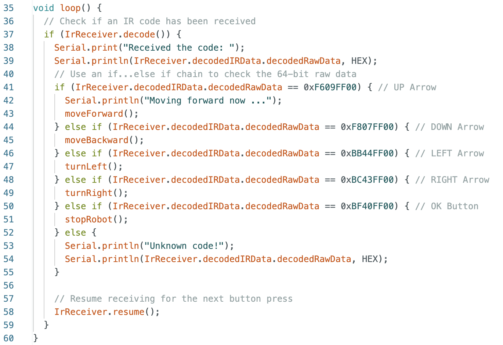

What is the use of a robot if it is always tethered to the computer! Today's goal is to wirelessly control the robot. Send commands without the need to connecting it to a laptop. I plan on doing this using an IR module receiver. I chose this because it is easy to setup and there was one already available in my kit. Eventually, I will switch to a bluetooth receiver. Checkout my [Day 2: Spinning the Wheels!](/day-2-spinning-the-wheels/) post where I manage to get the bot moving.

### Required Components

- IR receiver module (anyone will do as they all have the same pins and functionality)
- IR Remote (usually comes with the receiver)

### Setting Up the Circuit

Regardless of which IR module receiver you own, the three essential pins of the IR module receiver—GND, VCC, and SIG (SIG)—are always the same. Make sure to double-check the pinout diagram for your specific IR module receiver before proceeding with the circuit setup.

On most 3-pin IR receiver modules, these pins typically represent

- **VCC (Voltage Common Collector) or Power:** This pin provides the positive power supply to your module. Your 'R' pin is likely this.
- **GND (Ground):** This pin is the common ground for the module's circuit, connected to the Arduino's ground. Usually your 'G' pin is this.
- **OUT (Output) or Signal (SIG):** This pin transmits the decoded digital signal from the IR receiver to your Arduino's digital input pin. Your 'Y' pin is likely this.

To set up the actual circuit, we first connect the GND pin from the receiver to that of the Arduino to ensure common ground for its circuit. Then, we connect the VCC pin from the receiver to the 5V pin on the Arduino. This is because the receiver needs a 3-5V power supply to function properly. Finally, we can connect our SIG pin to any of the digital input pins, which we need to configure in our code later on.

### IR Receiver Code

The main change in our code will be the way we accept the commands to the bot. In the previous version, we had a parser which converts the text commands to the relevant C++ functions to call. In this version, we change this part to receive the commands from the remote. Different remotes have different layouts and each button send out a unique hex code. My first job is to figure out the codes for each of these buttons on the remote. For this, we have a small helper sketch which will wait for the button press and prints the hex code received to the screen. The code can be found here [remote\_codes\_finder.ino](https://github.com/sathvikr-motumtech/robocar/blob/f6250585a38029a09efd3608f3e6b1bddc088b3b/day2/remote_codes_finder.ino). This code uses an import which has to be downloaded first. You can do this by clicking on the "LIBRARY MANAGER" and searching for "IRremote". I used the first one by shirriff, z3t0, ArminJo.

Once I have all the hex codes noted for all the buttons I intend to use, I had to update the main code to accept these codes and call the appropriate commands. I still have the serial port initialized in this code for debugging purposes. This can be removed in the final version. Also note the use of "if ... else" statement instead of a "switch" statement. The hex code we get from the remote is 64 bits but the default integer value used in a "switch" statement on Arduino platform is 16/32 bits. Hence, the switch statement never gets executed correctly.

The rest of the move functions remain the same. You can reuse them from the previous version. The full code is here [ir\_remote\_controlled\_car.ino](https://github.com/sathvikr-motumtech/robocar/blob/f6250585a38029a09efd3608f3e6b1bddc088b3b/day2/ir_remote_controlled_car.ino)

### IR and Motor Interference

To begin with I started testing IR receiver and motors separately. They both worked perfectly. But once I have both on the same board I realized that the IR receiver was behaving very weirdly. I took help of my Dad who told me about IR interference. Turns out IR is very susceptible to electrical interference from things like motors and other electrical circuits. To handle this I ended up adding logic to stop motors completely when IR receiver is ready to receive codes. The updated code is checked into the github repo.

### Notes and Observations

**What are infrared signals?**

Infrared signals are a form of electromagnetic radiation, just like the visible light we see every day, radio waves, and even x-rays. Its wavelength is much longer than the regular light we see, therefore making it unable to be seen by the naked eye.

**How does it function****?**

When a button is pressed, an invisible light that includes modulated binary code is released by the infrared LED. Then, when it strikes the receiver core, which is sensitive to infrared light, it produces a little electrical current. To make them much easier to read, the amplifier amplifies the built-in filter, which ensures that it only "listens" to a particular frequency. Lastly, the demodulator eliminates the frequency and retrieves the original binary pulses. After that, the receiver transmits this information to the Arduino, which may translate it into hash values that we can use to program the bot.

**Advantages and Disadvantages of IR Signals:**

| Avantages | Disadvantages |
|---|---|
| **Low Cost:** Components are very inexpensive. | **Requires Line of Sight:** Must have a clear path between transmitter and receiver. Cannot go through walls or solid objects. |
| **Simple to Implement:** Easy to integrate into devices. | **Limited Range:** Usually only effective for short distances. |
| **No Licensing Required:** Operates on unregulated frequencies. | **Susceptible to Interference:** Strong IR sources (like direct sunlight, incandescent bulbs) can disrupt signals. |
| **No RF Interference:** Does not interfere with Wi-Fi, Bluetooth, or other radio-frequency devices. | **No Two-Way Communication (Typically):** Most common IR applications are one-way (e.g. Remote to TV, and almost never TV to remote) |
| **Basic Security :** Prevents accidental control of devices in other rooms, as signals are confined. | **Lack of Robust Security/Authentication:** Any compatible remote can potentially control a device if it knows the code. |
| **Low Power Consumption:** Ideal for battery-operated devices like remote controls. | **Lower Data Transfer Speeds:** Generally slower than modern wireless technologies like Wi-Fi or Bluetooth for data communication. |
