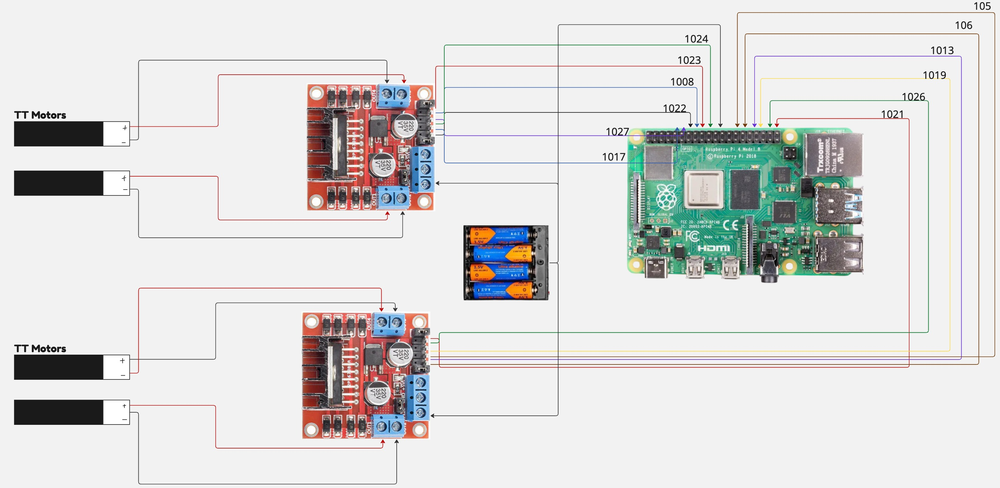

In the last few posts I made a basic remote controlled Robocar using Arduino Uno R3. Even though I call it a Robocar it is just a car which can follow a set of preprogrammed commands. There is nothing "Robotic" or "Intelligent" about it. With an ultimate goal of making an autonomous Robocar I have decided to upgrade the project to using a Raspberry Pi 5 as the main central processing unit. There are several reasons to doing this.

1. To run any kind of image processing or using ML for image recognization I need more processing power and RAM (memory). I have realized this while experimenting with Arduino that it really is very small in terms of raw computing power compared to a Raspberry Pi 5. It is not a fair comparison since they are really meant for different purposes. I made this [table](/day-1-setting-up-arduino-and-gathering-parts/) comparing a microcontroller (Arduino Uno R3) to a general purpose microcomputer (Raspberry Pi family of CPUs) in my other post.
2. I am more comfortable using a full fledged python development environment which is possible with Raspberry Pi. There are ways to make Arduino work with Python but not directly.
3. There are more GPIOs on the Raspberry Pi making it more easy to connect all the different motors and sensors. I can offload the motor and sensor controllers to Arduino with the Pi acting as the main supervisor and also running the compute intensive code like vision processing, etc on the Pi.

### Setting up Raspberry Pi

Setting up Raspberry Pi 5 is easy. I have followed the instructions on their official site [Setting Up Your Raspberry Pi](https://www.raspberrypi.com/documentation/computers/getting-started.html#setting-up-your-raspberry-pi). I had to use an imager program to flash the Raspbian OS on to a microSD card. Please pay special attention to "OS Customizations" in the imager program as this is required to setup the username and password and to enable SSH. If you don't do this you will not be able to login without an external monitor and a keyboard.

Developing using Raspberry Pi is different than with Arduino. Since Raspberry Pi has built-in WiFi you can set it up to connect to your local WiFi on bootup. I also enabled the SSH server while installing the OS which makes it easy to connect to it without any external monitors or keyboards. All I had to do is power up the Pi and login using the IP address which was assigned to it by my home network (in my case it was 192.168.1.10). Use SSH from a terminal app to connect to your Pi as follows

```bash
ssh sathvikr@192.168.1.10
```

Once you are in, you can fire up an editor of your choice (I used vi) and start coding. To simplify my Pi bringup I dropped the IR sensor out of the circuit since we will not be using it in our final finished prototype.

### Raspberry Pi Hardware Connections and Schematic Diagram

The connections are pretty much the same as with Arduino, the only difference being the GPIO numbering on the Pi. Also, for some reason the PWM pins on the Raspberry Pi 5 are not labeled as PWM or with a "\~" character as on the Arduino Uno. I had to search it up to find those (GPIO 12, 13, 18 and 19 can be configured to generate PWM signals). But for simplicity I ignored these too. I ended up using the digital signals to control the motor drivers.

The diagram below shows a single battery powering both the stepper motors and the the Pi but in reality I had used two batteries. This is because the single battery cannot provide for the current required by both the motors and the Pi.



### Python Code to Test the Setup

Here is the python code I used to test my connections. I used this small project as a launching pad for my final goal of creating an autonomous robocar which uses vision (couple of cameras) to go around a pre-marked area.

We use the following libraries to help us initialize the motors and work with GPIO pins. The *lgpio* library is a "low-level" library using the Linux kernel component to control the GPIO pins. The *gpio* library is a higher level abstraction which uses lgpio internally along with other libraries.

```python
import lgpio
from gpiozero import Motor
import time
```

Initializing the motors based on the schematic connections shown above is straightforward. The code below does that. Please note that the pin numbers in the code follows the BCM numbering.

```python
# Motor Pin Definitions (using BCM numbering)
#       (forward, backward, enable)
# --- Driver 1 (Right Side) ---
motor_r1 = Motor(forward=27, backward=17, enable=22)
motor_r2 = Motor(forward=18, backward=23, enable=24)

# --- Driver 2 (Left Side) ---
motor_l1 = Motor(forward=6, backward=13, enable=5)
motor_l2 = Motor(forward=19, backward=26, enable=21)

# Group motors for easier control
right_motors = [motor_r1, motor_r2]
left_motors = [motor_l1, motor_l2]
all_motors = right_motors + left_motors
```

Next, I wrote some functions to handle the different functions the car needs to perform. Capturing small functionality using functions like these makes the program more modular and easier to reason about.

```python
# --- Movement Functions ---

def stop_robot():
    """Stops all motors."""
    for motor in all_motors:
        motor.stop()

def move_forward():
    """Moves the robot forward."""
    for motor in right_motors:
        motor.forward(speed=SPEED)
    for motor in left_motors:
        motor.forward(speed=SPEED)
    time.sleep(MOVE_DURATION)
    stop_robot()

def move_backward():
    """Moves the robot backward."""
    for motor in right_motors:
        motor.backward(speed=SPEED)
    for motor in left_motors:
        motor.backward(speed=SPEED)
    time.sleep(MOVE_DURATION)
    stop_robot()
```

The code above shows how high-level coding can be with Python and the *gpio* library. Might not be great for understanding the low-level details but once you do that with say Arduino and C, this makes it more practical to use and accomplish a big project working alone. The turn\_left and turn\_right functions are trivial once you understand that to move right you need to turn the right side wheels forward and the left wheels backward. It is the opposite to turn the care left.

```python
def turn_left():
    """Turns the robot left on the spot."""
    for motor in right_motors:
        motor.forward(speed=SPEED) # Right wheels forward
    for motor in left_motors:
        motor.backward(speed=SPEED) # Left wheels backward
    time.sleep(TURN_DURATION)
    stop_robot()

def turn_right():
    """Turns the robot right on the spot."""
    for motor in right_motors:
        motor.backward(speed=SPEED) # Right wheels backward
    for motor in left_motors:
        motor.forward(speed=SPEED) # Left wheels forward
    time.sleep(TURN_DURATION)
    stop_robot()
```

Once you have these basic functions, you can test the setup by writing a small test code in the main like below. I am making this simple because this is only for testing the connections and setting up the workflow with Raspberry Pi and Python.

```python
if __name__ == "__main__":
    # A simple test sequence to ensure motors are wired correctly
    print("--- Motor Test Sequence ---")
    print("Forward...")
    move_forward()
    time.sleep(0.5)
    print("Backward...")
    move_backward()
    time.sleep(0.5)
    print("Left...")
    turn_left()
    time.sleep(0.5)
    print("Right...")
    turn_right()
    time.sleep(0.5)
    print("--- Test Complete ---")
```

I powered on the motor batteries and the code perfectly moved the car forward, backward, left and then right, testing all the code we have written above. That's it for today, it took me a while to finish this part since I was busy with school.
